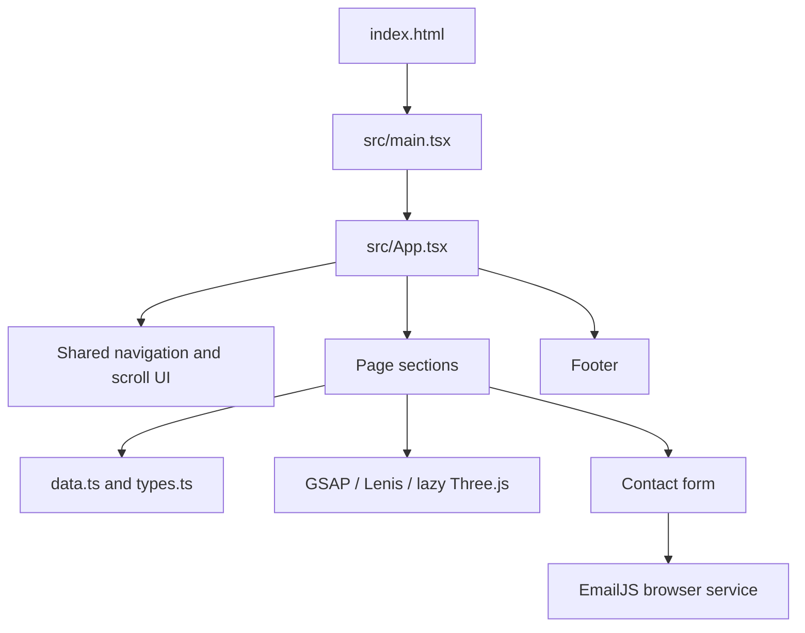

<div align="center">

# Sabir Ali — Full-Stack Engineer

### Thoughtful interfaces. Reliable systems. Built with intent.

My responsive, single-page portfolio brings together my engineering profile, selected projects, experience, and ways to get in touch.

[](https://react.dev/)
[](https://www.typescriptlang.org/)
[](https://vite.dev/)
[](https://tailwindcss.com/)
[](https://gsap.com/)
[](https://threejs.org/)
[](https://github.com/sabirsheik/sabir-dev/stargazers)
[](#license)
[](#deployment)

[View the repository](https://github.com/sabirsheik/sabir-dev) · [GitHub profile](https://github.com/sabiralidev) · [LinkedIn](https://www.linkedin.com/in/sabiralidev/)

</div>

> **Preview:** A real portfolio screenshot or GIF is not currently included in this repository. Add one here when available.
>
> _Suggested caption: Sabir Ali’s portfolio — a responsive, monochrome personal site with project, experience, and contact sections._

---

## Contents

- [Features](#features)
- [Tech stack](#tech-stack)
- [How it was built](#how-it-was-built)
- [Project structure](#project-structure)
- [How it works](#how-it-works)
- [Getting started](#getting-started)
- [Customization guide](#customization-guide)
- [Screenshots](#screenshots)
- [Roadmap](#roadmap)
- [Contributing](#contributing)
- [Deployment](#deployment)
- [License](#license)
- [Contact](#contact)

<a id="features"></a>
## ✨ Features

- 🧑‍💻 Personal introduction, engineering approach, skills, education, and certifications.
- 🗂️ Selected projects with descriptions, preview images, source repositories, and live project links.
- 📈 Experience timeline populated from typed portfolio data.
- 📬 Contact form with browser-side validation and EmailJS delivery.
- 🧭 Responsive navigation, active-section indicators, and reading progress.
- 🎞️ GSAP scroll animations, Lenis smooth scrolling, and a lazy-loaded Three.js hero visual.
- ♿ Reduced-motion handling and a static visual fallback when WebGL is unavailable.
- 📄 Downloadable résumé and direct social links.

<a id="tech-stack"></a>
## 🛠️ Tech stack

| Technology | Purpose |
| --- | --- |
| React 19 | Composes the page from reusable, interactive components. |
| TypeScript | Adds typed interfaces for the portfolio data and component code. |
| Vite 7 | Runs the local development server and bundles the static production site. |
| Tailwind CSS 3 | Applies responsive layout and visual styles through utility classes. |
| GSAP + ScrollTrigger | Coordinates entrance, scroll-based, and section reveal animations. |
| Lenis | Provides smooth scrolling and synchronizes scroll events with GSAP. |
| Three.js | Renders the decorative 3D hero scene. |
| Canvas 2D | Draws the ambient background particle effect. |
| Lucide React | Supplies the interface icons. |
| EmailJS browser SDK | Sends contact form submissions from the browser to the configured EmailJS service. |
| ESLint, TypeScript, PostCSS, Autoprefixer | Support linting, type-checking, and CSS processing. |

JavaScript, Node.js, Express.js, Next.js, MongoDB, and PostgreSQL are part of my broader engineering focus; they are **not** dependencies or backend services for this portfolio application.

<a id="how-it-was-built"></a>
## 🏗️ How it was built

The site is a front-end portfolio rather than a full-stack web service. Its structure separates the content from the components that present it.

<details>
<summary>Build story, step by step</summary>

1. **Start with the purpose.** The site needs to help visitors quickly understand who I am, what I work on, what I have built, and how to contact me.
2. **Organize the experience.** The page is divided into focused sections—Hero, About, Skills, Approach, Projects, Experience, and Contact—so visitors can scan the content or navigate directly to a topic.
3. **Create the app shell.** `index.html` provides the browser document and mounts the React application. `src/main.tsx` creates the React root, and `src/App.tsx` assembles the shared navigation, section components, and footer.
4. **Keep content in data.** `data.ts` stores projects, experience, skills, education, and certifications. `types.ts` defines the shapes of those records, while section components render the content.
5. **Build a consistent visual language.** Tailwind utility classes and global CSS provide the dark palette, typography, responsive layouts, and focus and reduced-motion styles. Inter and Geist Mono are loaded from Google Fonts.
6. **Add motion and interaction.** GSAP and ScrollTrigger animate content as the visitor scrolls. Lenis coordinates smooth scrolling. A lazy-loaded Three.js scene and a Canvas 2D background add visual depth; reduced-motion and WebGL fallbacks keep the page usable without those effects.
7. **Connect the contact form.** The form validates the visitor’s name, email, and message in the browser, then submits to EmailJS. No application server or contact API is included in this repository.
8. **Build for static hosting.** Vite and TypeScript produce the deployable site in `dist/`. The repository does not specify a hosting provider or live portfolio URL.

</details>

<a id="project-structure"></a>
## 📁 Project structure

```text
.
├── index.html                         # HTML document, metadata, fonts, and root mount point
├── data.ts                            # Projects, skills, experience, education, certifications
├── types.ts                           # Shared TypeScript data interfaces
├── package.json                       # Dependencies and npm commands
├── vite.config.ts                     # Vite plugins, build settings, and vendor chunks
├── tailwind.config.js                 # Tailwind content paths and theme extensions
├── postcss.config.js                  # Tailwind CSS and Autoprefixer configuration
├── public/                            # Static assets served from the site root
│   ├── Sabir.png                      # Hero portrait
│   ├── Sabir Resume.pdf               # Downloadable résumé
│   ├── ecom.png                       # E-commerce project preview
│   ├── AIworldTech.png                # AI World Tech project preview
│   ├── favicon.svg                    # Browser icon
│   └── robots.txt                     # Crawler instructions
└── src/
    ├── main.tsx                       # React entry point
    ├── App.tsx                        # Page assembly and global scroll behavior
    ├── index.css                      # Tailwind directives and global styles
    ├── App.css                        # Additional stylesheet; not imported by main.tsx
    ├── hooks/
    │   └── useReducedMotion.ts         # Tracks the user's reduced-motion preference
    └── components/
        ├── AboutSection/              # Professional overview
        ├── ApproachSection/           # Engineering principles
        ├── Common/                    # Navigation, shared UI, intro, progress, canvas, WebGL check
        ├── ContactSection/            # Contact links and EmailJS form
        ├── ExperienceSection/          # Typed experience timeline
        ├── Footer/                    # Footer links and location clock
        ├── HeroSection/               # Hero content and 3D scene
        ├── LogoReveal/                 # Additional logo components
        ├── ProjectsSection/            # Project cards and links
        └── SkillsSection/              # Skills, education, and certifications
```

<a id="how-it-works"></a>
## ⚙️ How it works

The browser loads `index.html`, which starts the React application at `src/main.tsx`. `App.tsx` composes the single-page experience. Each section owns its presentation and animation, while reusable UI elements live in `src/components/Common/`. Data-backed sections read typed content from `data.ts`.



### Contact submission flow

1. The visitor enters their name, email, and message.
2. The form validates the fields in the browser and shows field-level errors.
3. If the values pass validation, the EmailJS browser SDK sends the template parameters to the service and template configured in `src/components/ContactSection/ContactSection.tsx`.
4. The interface shows success or an error response.

The EmailJS identifiers are currently set in the component source, not read from environment variables. There is no backend endpoint in this project. Configure the EmailJS account and template appropriately before using the form on a public deployment.

<a id="getting-started"></a>
## 🚀 Getting started

### Prerequisites

- Node.js **20.19+** or **22.12+** (supported by the installed Vite 7 toolchain)
- npm
- Git

### Install and run

```bash
git clone https://github.com/sabirsheik/sabir-dev.git
cd sabir-dev
npm install
npm run dev
```

Vite prints the local URL in the terminal, typically `http://localhost:5173`.

### Check and build

```bash
npm run lint
npm run build
npm run preview
```

`npm run build` runs `tsc -b` before bundling the production site. The generated static files are written to `dist/`; `npm run preview` serves that build locally for a final check.

<a id="customization-guide"></a>
## 🎨 Customization guide

| To change | Update |
| --- | --- |
| Name, role, and hero copy | The relevant JSX in `src/components/HeroSection/HeroSection.tsx`, `src/components/Common/Navbar.tsx`, `src/components/Common/IntroLoader.tsx`, and `src/components/Footer/Footer.tsx`. |
| Projects, skills, education, certifications, or experience | The corresponding arrays in `data.ts`. Keep entries aligned with the interfaces in `types.ts`. |
| Project preview images | Replace the matching image files in `public/` and update the paths in `src/components/ProjectsSection/ProjectsSection.tsx` if filenames change. |
| Portrait and résumé | Replace `public/Sabir.png` or `public/Sabir Resume.pdf`. Keep the referenced public paths or update the components that link to them. |
| Colors and styling | Global color variables and motion rules are in `src/index.css`; Tailwind extensions are in `tailwind.config.js`. Many section-specific colors are also utility classes in component files. |
| GitHub, LinkedIn, DEV.to, and email links | Update the link values in the Hero, Contact, and Footer components. |
| Contact form delivery | Update the EmailJS service, template, public key, and template parameter mapping in `src/components/ContactSection/ContactSection.tsx`. |

After making changes, run `npm run lint` and `npm run build`.

<a id="screenshots"></a>
## 📸 Screenshots

Screenshots are not currently included in the repository. Add real captures in this section when available; the following are placeholders, not image links.

| Desktop | Mobile |
| --- | --- |
| `[Add a desktop screenshot here]` | `[Add a mobile screenshot here]` |

<a id="roadmap"></a>
## 🗺️ Roadmap

These are possible future improvements, not committed releases:

- Add desktop and mobile screenshots or a short preview GIF.
- Document a live portfolio URL and hosting provider once selected.
- Add a project-specific license if the owner intends to grant reuse rights.
- Consider moving EmailJS configuration out of component source and documenting the chosen deployment configuration.

<a id="contributing"></a>
## 🤝 Contributing

This is a personal portfolio. Suggestions and bug reports are welcome through GitHub Issues. For a proposed change, open an issue first to discuss scope, then submit a focused pull request with a clear description and the results of `npm run lint` and `npm run build`.

<a id="deployment"></a>
## 🌐 Deployment

The production output is a static Vite site in `dist/`. Deploy that directory to a static hosting provider and serve the app from the site root. No provider-specific deployment configuration or production URL is included in this repository, so the exact provider setup depends on the host you choose.

**Live demo:** `[Add the live portfolio URL when available]`

<a id="license"></a>
## 📄 License

No license file is present in this repository. Until a license is added, do not assume that the source code is licensed for reuse or redistribution.

<a id="contact"></a>
## 📬 Contact

- ✉️ **Email:** [sabirsheik12787@gmail.com](mailto:sabirsheik12787@gmail.com)
- 💼 **LinkedIn:** [linkedin.com/in/sabiralidev](https://www.linkedin.com/in/sabiralidev/)
- 🐙 **GitHub:** [github.com/sabiralidev](https://github.com/sabiralidev)
- ✍️ **DEV.to:** [dev.to/sabirsheikh](https://dev.to/sabirsheikh)

---

<div align="center">

If this portfolio or its implementation was useful to you, **⭐ Star this repository**.

</div>
